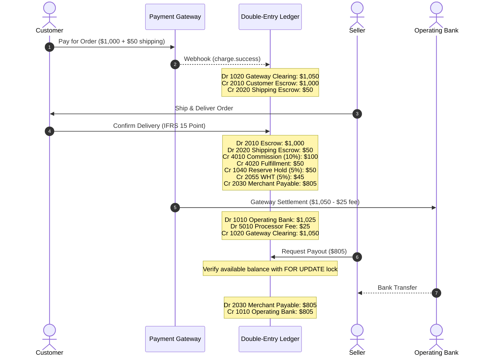

# Hamads Marketplace Double-Entry Accounting & Financial Management Module

## 1. Executive Accounting Architecture & Scope

This module implements a production-grade, auditable double-entry accounting foundation for Hamads marketplace operator (the reporting legal entity), integrated with FastAPI, SQLAlchemy 2.0 (async), PostgreSQL (`asyncpg`), Alembic, and React frontend features.

### Core Frameworks & Standards
* **Accounting Principles:** Strict double-entry ledger compliance ($\sum \text{Debits} = \sum \text{Credits}$ by currency).
* **IFRS 15 (Revenue from Contracts with Customers):** The platform operates primarily as an **Agent / Intermediary** for third-party sellers. It does not recognize the full Gross Merchandise Value (GMV) as platform revenue. Instead:
  - Customer payment is held as a **Customer Escrow Liability** upon capture.
  - Revenue recognition occurs upon **Order Delivery / Customer Satisfaction**, recognizing **Platform Commission Revenue** and **Fulfillment Service Fees**.
  - Net sales proceeds are transferred to **Merchant Payables**.
* **IAS 1 (Presentation of Financial Statements):** Structured Statement of Profit or Loss, Statement of Financial Position (Balance Sheet), and Trial Balance.
* **IAS 7 (Statement of Cash Flows):** Cash flows classified into Operating, Investing, and Financing activities, reconciling Net Income to Cash and Cash Equivalents via the indirect method.
* **IAS 32 / IFRS 9 (Financial Instruments & Liabilities):** Precise representation of receivables, escrow obligations, clearing in-transit funds, and merchant payables using PostgreSQL `NUMERIC(18, 4)`.

---

## 2. Policy Assumptions & Configuration Guide

> [!IMPORTANT]
> The following default settings are pre-configured. A certified local accountant or finance controller should review and adjust these settings prior to official tax filings.

1. **Functional / Base Currency:** Default is `NGN` (Nigerian Naira) or `USD`. Multi-currency transactions track both transaction currency and base currency amounts along with the FX conversion rate and date.
2. **Marketplace Commission Policy:** Default standard commission is 10.0% (`0.1000`) of item subtotal. Platform commission is recognized as earned income when seller orders reach `DELIVERED`.
3. **Dispute Safety Reserve Holds:** Default hold is 5.0% (`0.0500`) of vendor sales proceeds, held in reserve account `1040` for 14 days following delivery to protect against customer return claims and chargebacks.
4. **Withholding Tax (WHT):** Configured as 5.0% (`0.0500`) on vendor commissions/fees under jurisdiction rules (e.g., Nigeria FIRS regulations).
5. **Period Close Policy:** Fiscal periods (e.g., monthly) can be locked (`LOCKED`/`CLOSED`). Once closed, no draft or new entries may be posted without privileged administrative unlock and an audit log justification.
6. **Payment Provider Authorization & Settlement:** Paystack is the primary provider. Orders are only acknowledged as paid upon verified HMAC-SHA512 webhook signature verification. Payment clearing account `1020` tracks in-transit settlements until bank payouts clear into operating bank account `1010`.

---

## 3. Chart of Accounts (CoA) Structure

| Account Code | Account Title | Category | Normal Balance | Description |
| :--- | :--- | :--- | :--- | :--- |
| **1010** | Operating Settlement Bank Account | Asset | Debit | Primary corporate cash account |
| **1020** | Payment Gateway Clearing Account | Asset | Debit | In-transit customer payments from Paystack/Stripe |
| **1030** | Accounts Receivable | Asset | Debit | B2B / corporate partner receivables |
| **1040** | Merchant Reserve Funds Held | Asset | Debit | Safety reserve cash held against dispute claims |
| **2010** | Customer Escrow Liability | Liability | Credit | Customer funds held pending order fulfillment |
| **2020** | Customer Shipping Fee Liability | Liability | Credit | Delivery fees collected in escrow |
| **2030** | Merchant Payables | Liability | Credit | Withdrawable balance owed to verified sellers |
| **2040** | Customer Refunds Payable | Liability | Credit | Unsettled customer refunds and store credits |
| **2050** | VAT Payable | Liability | Credit | Value Added Tax collected payable to tax authority |
| **2055** | Withholding Tax (WHT) Payable | Liability | Credit | Tax deducted from vendor disbursements |
| **2060** | Unearned Platform Revenue | Liability | Credit | Prepaid subscriptions or featured advertising |
| **3010** | Contributed Share Capital | Equity | Credit | Owners' paid-in equity capital |
| **3020** | Retained Earnings | Equity | Credit | Cumulative earnings from prior financial periods |
| **4010** | Platform Commission Revenue | Revenue | Credit | IFRS 15 agent commission earned on delivered goods |
| **4020** | Fulfillment & Delivery Revenue | Revenue | Credit | Shipping fees earned for platform logistics |
| **4030** | Advertising & Merchant Promotion | Revenue | Credit | Fees for featured placement and ads |
| **4040** | Payment Processing Surcharges | Revenue | Credit | Transaction surcharges passed to customers |
| **5010** | Payment Gateway Processing Fees | Expense | Debit | Acquiring charges from payment processors |
| **5020** | Logistics & Courier Fulfillment Outflows | Expense | Debit | Payments to third-party delivery dispatchers |
| **5030** | Platform Hosting & IT Infrastructure | Expense | Debit | AWS, Redis, server, and SaaS operating expenses |
| **5040** | Dispute, Return & Loss Absorption | Expense | Debit | Chargeback absorption and merchant claim losses |

---

## 4. Double-Entry Posting Lifecycle Matrix

---

## 5. Security, Concurrency, and Idempotency Controls

1. **Row-Level Database Locking (`with_for_update()`):**
   - Vendor balance queries and payout reservations acquire an exclusive row lock on the seller record and ledger lines to prevent concurrent double-spend race conditions.
2. **Idempotency Keys:**
   - Every financial webhook and API submission requires or derives a unique idempotency key (e.g., `PAYMENT-{gateway_ref}`, `DELIVERY-{seller_order_id}`). Repeated requests return the existing record without duplicate postings.
3. **Immutability Invariant:**
   - Posted journal entries cannot be updated or deleted. Reversals create explicit offsetting entries linked via `reverses_entry_id` and `reversed_by_id`.
4. **Data Privacy & Tenant Isolation:**
   - Endpoints under `/seller/accounting/` enforce that authenticated sellers can only access their own statement and payout queue. Cross-seller leakage is blocked at the query level.
